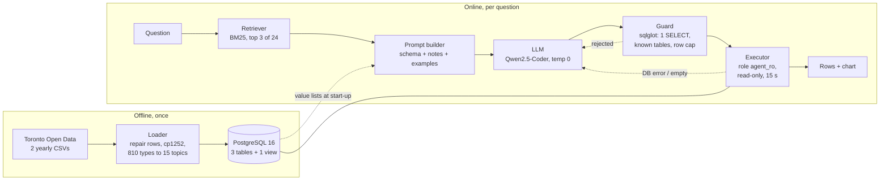

# Ask Toronto 311

**A text-to-SQL agent over 937,312 Toronto 311 service requests, run on small open-weight models on a CPU and on Claude through the API, and measured on 100 hand-checked questions.**

[Results page](https://mayank-thite.github.io/ask-toronto-311/) · [Full evaluation report](eval/REPORT.md) · [Per-question results](eval/results/)

```
$ python -m ask311 "Which 5 wards had the most missed collection requests in 2025?"

SELECT ward_name, COUNT(*) AS requests FROM v_requests
WHERE topic = 'Missed collection' AND EXTRACT(YEAR FROM created_at) = 2025 AND ward_id IS NOT NULL
GROUP BY ward_name ORDER BY requests DESC LIMIT 5

ward_name               requests
Beaches-East York       5487
Toronto-Danforth        5437
Scarborough Southwest   4119
Scarborough-Rouge Park  4065
Don Valley West         3705
```

## Summary

| | |
|---|---|
| Execution accuracy, Qwen2.5-Coder 7B (local, 4-core CPU) | **83 / 100** (95% CI 74 to 89), 12.3 s median, $0 |
| Execution accuracy, Claude Haiku / Sonnet / Opus 5.5 (API) | **97 / 98 / 99**, 1 to 2 s median, $0.01 to $0.39 for all 100 questions |
| Same 3B model, tables only → notes + retrieved examples | **36 → 73** (exact McNemar p < 0.001 for each step) |
| Claude Sonnet 5.5, tables only → full context | **76 → 98** (+23 / −1, p < 0.001) |
| Questions rescued by self-correction | **0** on local models. Remaining misses are silent wrong answers, not errors |

What this shows: context (a small semantic layer and a few retrieved examples) moved accuracy more than anything else, and that holds for frontier models too. Without context, Sonnet does no better than a local 7B model with it (76 vs. 83, p = 0.25). Every claim here comes from saved per-question outputs, with intervals and paired tests.

## 1. Architecture



| Module | Responsibility |
|---|---|
| `load.py` | Downloads the 2024 and 2025 files, repairs rows split by unquoted commas, decodes cp1252, nulls "Intersection" postal codes, bulk-loads with `COPY` |
| `topics.py` | Ordered regex rules mapping 810 raw request types to 15 topics. The city renamed many types between years, so this is what makes "how many potholes" answerable |
| `schema_context.py` | Builds the schema block and the data notes. Value lists (statuses, divisions, topics, date range) are read from the database, so the notes can't drift |
| `retrieval.py` | BM25 over 24 solved examples (`examples.yaml`). None overlap with the test set |
| `agent.py` | The loop: prompt, extract SQL, guard, execute, feed errors back (max 2 retries) |
| `llm.py`, `claude_llm.py` | Model adapters with one `chat()` method: any OpenAI-compatible server (local models), or Claude through the Anthropic SDK with prompt caching and a spend cap |
| `guard.py` | sqlglot parse; exactly one SELECT/UNION; allowlisted tables and CTEs; adds `LIMIT 500` |
| `sql/schema.sql` | Schema, the joined view, and the `agent_ro` role (SELECT grants, read-only transactions, 15 s timeout) |
| `compare.py` | Result-set comparison used for scoring |

### The agent loop

```python
examples = bm25.search(question, k=3)
messages = [system, schema + notes + examples + question]
for attempt in range(1 + max_retries):                 # max_retries = 2
    sql = extract_sql(llm.chat(messages, temperature=0))
    try:
        rows = db.run(guard.check(sql), role="agent_ro")
        if rows or already_retried_empty: return rows
        feedback = "returned no rows; check filter values against the notes"
    except (UnsafeSQL, DatabaseError) as e:
        feedback = str(e)                              # the model sees the real error
    messages += [assistant(sql), user(feedback + " Reply with the corrected SQL only.")]
```

The result rows are the answer. The model never writes a prose summary, so there's no second place for it to hallucinate. The chart type (single number, line or bar) is picked by rules from the result's shape.

## 2. How the model is used

| Setting | Value | Reason |
|---|---|---|
| Models | Qwen2.5-Coder Instruct 1.5B / 3B / 7B (local); Claude Haiku 5.5, Sonnet 5.5, Opus 5.5 (API) | Open weights that fit a CPU, against hosted models at three price points |
| Weights | GGUF Q4_K_M (4-bit) | 7B runs in about 5 GB RAM |
| Serving | llama.cpp server or Ollama; Anthropic SDK for Claude | Two adapters behind one `chat()` method, so the agent and the evaluation never change |
| Decoding | Local: temperature 0, max 400 tokens. Claude: effort `low` (adaptive thinking, no sampling settings) | Greedy local output for paired comparisons. Low effort keeps Claude cheap and fast on short SQL tasks |
| Output contract | one query in a fenced `sql` block | Extracted by regex, validated by sqlglot, rejected with a reason otherwise |
| Calls per question | 1.03 average (7B) | Retries fire only on loud failures |

**Prompt budget** (one real question, 7B tokenizer): system 32 · tables and columns 128 · **data notes 681** · 3 examples 248 · question 19. That's about 1,100 tokens in and about 50 out.

**Prompt ordering for the KV cache.** The static parts (system, schema, notes) come first and the per-question parts (examples, question) last. llama.cpp reuses the KV cache for a matching prefix. Over the 7B run it reused about 870 tokens per question and evaluated about 190 new ones, so roughly 80% of prompt processing was skipped. On a CPU, that's the dominant cost.

**Prompt caching on Claude.** The same ordering pays off with the API. The Claude adapter sends the schema and notes as their own content block with a cache marker, so every question after the first reads them at a tenth of the input price. Over a full run, about 78% of input tokens came from the cache. The adapter also adds up the real cost from each response's usage numbers and stops the run before it passes `--max-usd`.

## 3. Evaluation method

- **Test set** (`eval/questions.yaml`). 100 questions, 20 in each of 5 categories: simple filters, time logic, rankings, data traps (renamed types, a division reorganisation, NULL semantics, what "open" means) and multi-step queries (ratios, windows, HAVING, set operations). Each has gold SQL. A CI test runs every gold query against the real data, checks it returns rows, and checks that no `LIMIT` boundary cuts through a tie.
- **Metric.** Execution accuracy. The predicted result set must match the gold result set. Column names and extra columns are ignored. Numbers match to 2 decimals. Order counts only when the gold query sorts (with an explicit tie column where needed). For "which X" questions, only the label column must match. Month numbers are accepted for month dates inside a single year. Each rule has a unit test.
- **Leakage control.** The retrievable examples are a separate, disjoint set.
- **Ablation.** One component is added per run on the 3B model. Greedy decoding makes every pair of runs a paired comparison.
- **Statistics.** 95% Wilson intervals. Exact McNemar tests on the questions where two runs disagree (`eval/stats.py`).
- **Scoring change.** After the first runs, the label-only and month-number rules were added because correct answers were being failed. Every saved run was then re-scored from its stored SQL (`eval/rescore.py`) without re-running any model. Scores rose 2 to 8 points, and the order of setups didn't change.
- **Environment.** 4 vCPU, 15 GB RAM, no GPU, llama-cpp-python 0.3.36.

## 4. Results

### Ablation (Qwen2.5-Coder 3B)

| Setup | Correct | 95% CI | vs row above (newly right / newly wrong) |
|---|---|---|---|
| Tables and columns only | 36 | 27 to 46 | |
| + data notes | 55 | 45 to 64 | +24 / −5, p < 0.001 |
| + 3 retrieved examples | 73 | 64 to 81 | +22 / −4, p < 0.001 |
| + self-correction (2 retries) | 73 | 64 to 81 | +0 / −0, p = 1.00 |
| + "don't copy filters" instruction | 71 | 62 to 79 | +0 / −2, p = 0.50 |

- **Notes** fixed lookups against values the model couldn't see. Rankings went from 35 to 85 and data traps from 30 to 55.
- **Examples** taught patterns (FILTER, window functions, HAVING). Multi-step went from 5 to 40.
- **Self-correction** had nothing to work on. With context, only 3 of 100 queries failed loudly, and none were fixed in 2 retries. The other 24 misses executed cleanly and returned wrong numbers.
- **The "don't copy" instruction** targeted a real failure mode (below) and didn't help. It's off by default and kept in the record.

### Model size (full agent)

| Model | Correct | 95% CI | Median | p90 | vs smaller |
|---|---|---|---|---|---|
| Qwen2.5-Coder 1.5B | 64 | 54 to 73 | 5.2 s | 8.7 s | |
| Qwen2.5-Coder 3B | 73 | 64 to 81 | 6.9 s | 11.8 s | +14 / −5, p = 0.06 |
| Qwen2.5-Coder 7B | **83** | 74 to 89 | 12.3 s | 20.1 s | +16 / −6, p = 0.05 |

Bigger is better, but neither step clears p < 0.05 on 100 questions. The context effect is the stronger result. 3B to 7B costs about 1.8 times the latency for 10 points. Per-category numbers are in [eval/REPORT.md](eval/REPORT.md).

### Hosted models: Claude (full agent, effort low)

| Model | Correct | 95% CI | Median | Run cost (100 Qs) | Per correct answer | vs Qwen 7B |
|---|---|---|---|---|---|---|
| Claude Haiku 5.5 | **97** | 92 to 99 | 1.0 s | $0.012 | $0.0001 | +15 / −1, p < 0.001 |
| Claude Sonnet 5.5 | **98** | 93 to 99 | 1.7 s | $0.19 | $0.002 | +15 / −0, p < 0.001 |
| Claude Opus 5.5 | **99** | 95 to 100 | 2.1 s | $0.39 | $0.004 | +16 / −0, p < 0.001 |
| Claude Sonnet 5.5, tables only | 76 | 67 to 83 | 1.9 s | $0.20 | $0.003 | +10 / −17, p = 0.25 |

- **Hosted beats local clearly.** Haiku gets 14 more right than the 7B, about 12 times faster, for about a cent for all 100 questions.
- **The set is saturated for hosted models.** 97, 98 and 99 overlap. No pair differs significantly (Haiku vs. Opus: +2 / −0, p = 0.50). Ranking them needs harder questions.
- **Context isn't only for small models.** Sonnet with tables only scores 76, no better than the 7B with context (83, p = 0.25). Adding notes and examples back is +23 / −1 (p < 0.001). All 24 of its misses are silent wrong results, with no invalid SQL.
- **What's left is data traps.** The 6 misses across the three full runs fall on 3 questions. All three models count "dead animal" requests by keyword and get 493. The city files most of them under "cadaver", and the true count is 34,492. That's a gap in the notes, not in the model.
- API latency includes the network and isn't comparable to the local CPU numbers.

## 5. Error analysis (7B, all 17 misses hand-labelled)

| Cause | Misses | Example |
|---|---|---|
| Concept mapping | 4 | searched `request_type` for "missed collection" instead of using `topic` |
| Copied example filter | 3 | added `year = 2025` because a retrieved example had it |
| Aggregation logic | 3 | filtered to Noise in `WHERE`, so every ward's noise share became 100% |
| Output shape | 3 | answered "how many days..." with one row per day |
| Wrapping time range | 2 | "11 pm to 5 am" written as `BETWEEN 23 AND 5` |
| Decomposition | 2 | ranked topics by volume instead of by year-over-year change |

All six causes are silent: the query runs and returns something plausible. The 7B model still makes every one of them, so scale alone isn't closing them. Per-question labels are in [`eval/error_labels.yaml`](eval/error_labels.yaml).

## 6. Design decisions

| Decision | Alternative | Why |
|---|---|---|
| Topic layer in the database (tested regex rules) | Let the model search 810 type names | Types were renamed mid-period. A deterministic mapping is cheaper and testable |
| One joined view | Base tables only | Fewer joins to get wrong. Base tables are still available |
| BM25 retrieval | Embeddings + vector store | 24 short examples don't need a second model. Retrieval sits behind one class |
| Parser allowlist **and** read-only DB role | Prompt instructions | A prompt isn't a security boundary. A test proves `DELETE` fails at the database |
| Greedy decoding | Sampling | Reproducibility and paired statistics. Sampling is reserved for voting |
| Rows as the answer | LLM-written summary | One fewer hallucination surface, half the calls |
| Two thin adapters (OpenAI-compatible, Anthropic SDK) | One generic client | Each uses its provider's own features (llama.cpp prefix reuse, Claude prompt caching and effort) while the agent stays unchanged |
| Spend cap inside the adapter | Watching the bill | A run can't overspend. Results are saved per question, so a stopped run resumes |

## 7. Limitations and next steps

- **100 questions** gives about ±9 point intervals. Differences under about 10 points aren't reliable.
- **One author** wrote the questions, gold SQL, notes and examples, so the notes likely fit the test set better than they'd fit outside questions.
- **No confidence signal.** The agent can't tell a silent wrong answer from a right one, and that's where the remaining error is.
- **Single-turn.** It doesn't ask clarifying questions.
- **Ceiling effect.** Hosted models score 97 to 99, so this set ranks local models but can't separate hosted ones.

Next steps, by expected gain per hour:

1. **Result-shape check.** A "how many" question that returns more than one row gets sent back. Targets 3 misses.
2. **Two notes.** One on wrapping time ranges and one on preferring `topic` over keyword search. Targets 6 misses.
3. **Self-consistency.** Sample 5 queries, execute all of them, and keep the majority result. This is the standard defence against silent errors, at about 5 times the compute.
4. **A harder, 300-question test set**, partly written by someone else, with ambiguous phrasing and multi-table questions. It would also separate the hosted models.

## 8. Data problems found while loading

- 70,408 rows have 10 fields instead of 9. Division names like "Parks, Forestry & Recreation" contain unquoted commas. They're rejoined using the known division names, and one section name gets the same fix.
- The files are Windows-1252, not UTF-8.
- 141,355 requests have the literal "Intersection" in the postal code column. These are stored as NULL, and the street names live in two other columns.
- Forestry moved from Parks (2024) to Environment, Climate & Forestry (2025).

## Run it

Requirements: Python 3.11+, Docker (or PostgreSQL 14+), and Ollama or an Anthropic API key.

```bash
git clone https://github.com/Mayank-thite/ask-toronto-311 && cd ask-toronto-311
pip install -r requirements.txt
docker compose up -d
PYTHONPATH=src python -m ask311.load          # about 13 MB download, 937k rows
ollama pull qwen2.5-coder:7b
PYTHONPATH=src python -m ask311 "How many pothole requests came in during the spring of 2025?" --show-attempts
```

Evaluate and rebuild the report:

```bash
python eval/run_eval.py --name my-run --model qwen2.5-coder:7b    # about 23 min on 4 CPU cores
python eval/report.py                                            # REPORT.md, charts, docs/index.html
pytest                                                           # unit tests; CI also loads the real data
```

Claude instead of a local model (needs `ANTHROPIC_API_KEY`):

```bash
python eval/run_eval.py --name claude-haiku-full --provider claude --model claude-haiku-5-5 --max-usd 1
```

Flags `--schema bare|notes`, `--examples N`, `--retries N` and `--example-guard` reproduce each ablation row.

## Layout

```
src/ask311/   agent, guard, retrieval, schema notes, topics, loader, charts, CLI
sql/          schema, joined view, read-only role
eval/         questions, runner, re-scorer, stats, error labels, report, saved results
docs/         results page (GitHub Pages)
tests/        guardrails, scoring rules, statistics, topics, gold SQL, read-only role
```

## Data and licences

City of Toronto Open Data, [311 Service Requests – Customer Initiated](https://open.toronto.ca/dataset/311-service-requests-customer-initiated/), Open Government Licence – Toronto. Qwen2.5-Coder 1.5B and 7B are Apache 2.0. The 3B model has the Qwen Research licence (used here for non-commercial evaluation only). Code: MIT.
