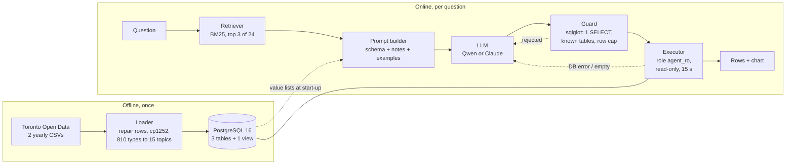

# Ask Toronto 311

Type a question about Toronto's 311 requests in plain English. Get back the answer, pulled straight from the city's data, along with the SQL query that found it.

[Results page](https://mayank-thite.github.io/ask-toronto-311/) · [Full evaluation report](eval/REPORT.md) · [Every answer the models gave](eval/results/)

```
$ python -m ask311 "Which 5 wards had the most missed collection requests in 2025?"

SELECT ward_name, COUNT(*) AS requests FROM v_requests
WHERE topic = 'Missed collection' AND EXTRACT(YEAR FROM created_at) = 2025 AND ward_id IS NOT NULL
GROUP BY ward_name ORDER BY requests DESC LIMIT 5

ward_name               requests
Beaches-East York       5487
Toronto-Danforth        5437
Scarborough Southwest   4119
Scarborough-Rouge Park  4065
Don Valley West         3705
```

## Why I built this

When a pothole opens up on your street or the garbage truck skips your house, you call 311. Toronto publishes every one of those calls as open data. In 2024 and 2025 alone there were 937,312 of them.

That's a lot of useful information. Which wards get missed most often on garbage day? Did pothole complaints jump after the winter? How many noise complaints come in after midnight? The answers are all in there.

But getting them out isn't easy. You need to know SQL, and you need to know the data's quirks. The city renamed many request types between 2024 and 2025. Some postal codes are just the word "Intersection". If you search for "dead animal" you'll find 493 requests, but the real number is 34,492, because most are filed under "Cadaver".

So most people who could use this data never touch it. I wanted to see if a language model could close that gap, and more importantly, whether its answers could be trusted.

## What it does

You ask a question. Behind the scenes, the agent:

1. Looks up a few similar questions it already knows the answers to.
2. Asks a language model to write a SQL query. Along with your question, the model gets the table layout and a page of notes about the data's traps.
3. Checks the query before running it. It has to be one read-only `SELECT`, nothing else.
4. Runs it with a database login that can't change or delete anything.
5. If the query fails, it shows the model the error and lets it try again, up to twice.
6. Gives you the result table, a chart if the result suits one, and the SQL.

The model never writes the answer in its own words. You get the actual rows from the database, so it can't make up a number, and you can always check how it got there.

## The data

The data comes from the City of Toronto's open data portal: [311 Service Requests – Customer Initiated](https://open.toronto.ca/dataset/311-service-requests-customer-initiated/), 2024 and 2025. Each row is one request.

I load it into PostgreSQL as three tables and one view:

| Table | Rows | What's in it |
|---|---|---|
| `service_requests` | 937,312 | When the request was made, its status, the first 3 characters of the postal code, the ward, the request type, and which city division handled it |
| `request_types` | 810 | Every request type name the city used, each mapped to a simple topic |
| `wards` | 25 | Ward number and name |
| `v_requests` | 937,312 | A view that joins all three. This is what the agent queries |

Here's one row:

| created_at | status | postal_fsa | ward_name | request_type | topic | division |
|---|---|---|---|---|---|---|
| 2024-01-01 08:53 | Completed | M4G | Don Valley West | Road - Sinking | Potholes and road damage | Transportation Services |

The `topic` column is something I added. The city used 810 different names for request types, and nobody asking about potholes would think to include "Road - Sinking". So the loader sorts every type into one of 15 topics, like Bins, Potholes, Noise or Trees, using rules that are covered by tests (`topics.py`). The biggest are bins (163k), missed collection (126k), property and bylaw (106k), and animals and wildlife (100k).

A few things the data doesn't have: exact addresses, the text of the complaint, or when the request was closed. So you can't ask how long the city took to fix something.

## What I wanted to find out

A demo that answers five questions is easy to build. I wanted to know how often it's actually right, and what makes it better.

So I wrote 100 test questions, each with a correct SQL query I checked by hand. They fall into five groups of 20: simple counts, questions about time, rankings, data traps, and multi-step questions. A question counts as right only if the agent's query returns the same result as the correct one.

Then I ran three experiments:

1. **Does context help?** I started a small model with just the table layout, then added the data notes, then the example questions, then the retry step, one at a time.
2. **Does a bigger model help?** I tried three sizes of Qwen2.5-Coder, a free model that runs on a laptop CPU (1.5, 3 and 7 billion parameters).
3. **How do paid models compare?** I ran Claude Haiku, Sonnet and Opus through Anthropic's API, using the same agent and the same 100 questions, and tracked what each run cost.

## What I found

| Setup | Right (of 100) | Time per question | Cost for all 100 |
|---|---|---|---|
| Qwen 3B, table layout only | 36 | 6 s | free |
| Qwen 3B, with notes and examples | 73 | 7 s | free |
| Qwen 7B, with notes and examples | 83 | 12 s | free |
| Claude Sonnet 5.5, table layout only | 76 | 2 s | $0.20 |
| Claude Haiku 5.5, with notes and examples | 97 | 1 s | $0.01 |
| Claude Sonnet 5.5, with notes and examples | 98 | 2 s | $0.19 |
| Claude Opus 5.5, with notes and examples | 99 | 2 s | $0.39 |

**Context mattered most.** Adding the notes and examples doubled the small model's score, from 36 to 73. It made a big difference for Claude too: Sonnet went from 76 to 98. Without the notes, a top model did no better than a free 7B model that had them.

**The retry step barely helped.** On the local models it fixed nothing. When the agent got a question wrong, the query usually ran fine and just returned the wrong number. There was no error for it to fix.

**Claude was more accurate, faster and still cheap.** Haiku got 14 more questions right than the best free model, answered in about a second, and the whole test cost about a cent.

**The test is now too easy for Claude.** Haiku, Sonnet and Opus scored 97, 98 and 99. With only 100 questions, that gap is too small to call one better than another. Telling them apart needs harder questions.

### Why a better model matters here

When this agent gets something wrong, nothing looks wrong. You get a clean table with a believable number in it. Almost every mistake in the test was like that. So the score is really telling you how often someone would walk away with a bad number and not know it.

- At 83 out of 100 (the free 7B model), about 1 answer in 6 is quietly wrong. That's fine for poking around the data, but risky if the number is going into a report.
- At 97 (Haiku), it's about 1 in 33.
- At 99 (Opus), it's about 1 in 100.

Speed matters too. Twelve seconds per question is fine when you're exploring, but it doesn't feel like a conversation. One or two seconds does.

The trade-off is cost and privacy. The local model is free and your data never leaves your machine. Claude is faster and more accurate, but each question is sent to an outside service. The numbers above should make that choice easier.

## How to run it

You'll need Python 3.11 or newer, Docker (or your own PostgreSQL 14+), and one of these:

- **[Ollama](https://ollama.com)** to run the free model on your own computer. The 7B model needs about 5 GB of free memory.
- **An Anthropic API key** to use Claude. A run of all 100 test questions costs between 1 and 40 cents, depending on the model.

**1. Get the code and install it**

```bash
git clone https://github.com/Mayank-thite/ask-toronto-311
cd ask-toronto-311
pip install -r requirements.txt -e .
```

**2. Start the database**

```bash
docker compose up -d
```

This starts PostgreSQL 16 on port 5432 with the user, password and database the code expects (see `.env.example`).

**3. Load the data**

```bash
python -m ask311.load
```

This downloads about 13 MB from the city's portal, fixes the broken rows, and loads all 937,312 requests. It takes a few minutes.

**4a. Ask a question with the free local model**

```bash
ollama pull qwen2.5-coder:7b
python -m ask311 "How many pothole requests came in during the spring of 2025?"
```

**4b. Or ask with Claude**

```bash
export ANTHROPIC_API_KEY=your-key-here
python -m ask311 "How many pothole requests came in during the spring of 2025?" --claude
```

This uses Haiku. To pick another model, pass its name, for example `--claude claude-sonnet-5-5`. Add `--show-attempts` to see each query the model tried.

**5. Run the 100-question test yourself (optional)**

```bash
# Free model: about 23 minutes on a 4-core CPU
python eval/run_eval.py --name my-run --model qwen2.5-coder:7b

# Claude: a few minutes, stops itself before spending more than --max-usd
python eval/run_eval.py --name my-claude-run --provider claude --model claude-haiku-5-5 --max-usd 1

# Rebuild the report, charts and results page from every saved run
python eval/report.py

# Unit tests
pytest
```

To repeat the context experiment, use `--schema bare` (table layout only), `--examples 0` (no example questions) and `--retries 0` (no retry step).

---

## Technical details

Everything below is for readers who want to know exactly how it's built and measured.

### Architecture



| File | What it does |
|---|---|
| `load.py` | Downloads both years, repairs rows that unquoted commas split in two, reads the cp1252 encoding, sets "Intersection" postal codes to NULL, and bulk-loads with `COPY` |
| `topics.py` | Ordered regex rules that map the 810 request types to 15 topics |
| `schema_context.py` | Builds the table description and the data notes. Lists of valid values (statuses, divisions, topics, date range) come from the database, so the notes can't go stale |
| `retrieval.py` | BM25 search over 24 solved example questions (`examples.yaml`). None of them appear in the test set |
| `agent.py` | The main loop: build the prompt, pull out the SQL, check it, run it, and send errors back (2 retries at most) |
| `llm.py`, `claude_llm.py` | Two model adapters with the same `chat()` method. One talks to any OpenAI-compatible server (Ollama, llama.cpp). The other uses the Anthropic SDK, with prompt caching and a spending cap |
| `guard.py` | Parses the query with sqlglot. Allows exactly one SELECT (or UNION), only known tables, and adds `LIMIT 500` |
| `sql/schema.sql` | Tables, the joined view, and the read-only `agent_ro` login (SELECT only, read-only transactions, 15 s timeout) |
| `compare.py` | Compares two result sets for scoring |

The loop, simplified:

```python
examples = bm25.search(question, k=3)
messages = [system, schema + notes + examples + question]
for attempt in range(1 + max_retries):                 # max_retries = 2
    sql = extract_sql(llm.chat(messages))
    try:
        rows = db.run(guard.check(sql), role="agent_ro")
        if rows or already_retried_empty: return rows
        feedback = "returned no rows; check filter values against the notes"
    except (UnsafeSQL, DatabaseError) as e:
        feedback = str(e)                              # the model sees the real error
    messages += [assistant(sql), user(feedback + " Reply with the corrected SQL only.")]
```

### Model setup

| Setting | Value | Why |
|---|---|---|
| Local models | Qwen2.5-Coder Instruct 1.5B, 3B, 7B, as 4-bit GGUF (Q4_K_M) | Trained on code, open weights, small enough for a CPU. The 7B needs about 5 GB of RAM |
| Hosted models | Claude Haiku 5.5, Sonnet 5.5, Opus 5.5 | Three price points from one provider |
| Local decoding | temperature 0, max 400 tokens | The same input always gives the same output, so two runs can be compared question by question |
| Claude settings | effort `low` | Writing one SQL query doesn't need much thinking. Low effort keeps it fast and cheap |
| Output format | One query in a ```` ```sql ```` block | Pulled out with a regex and checked by sqlglot. Anything else is rejected with a reason |

The prompt for one question is about 1,100 tokens: system message 32, table layout 128, data notes 681, three examples 248, the question 19.

The parts that never change (system message, layout, notes) come first, and the parts that change (examples, question) go last. That ordering pays off twice. Locally, llama.cpp reuses its cache for the shared start of the prompt, which skipped about 80% of the prompt work on the 7B run. With Claude, the fixed part is marked for prompt caching, so after the first question it's billed at a tenth of the normal price. About 78% of input tokens in each Claude run came from the cache.

### How it's scored

- **Test set** (`eval/questions.yaml`): 100 questions, 20 in each group. Every correct query is run against the real data in CI, which also checks that no `LIMIT` cuts a tie in half.
- **What counts as right:** the agent's result must match the correct result. Column names and extra columns don't matter. Numbers must match to 2 decimal places. Row order matters only when the question asks for a sorted answer. For "which ward" style questions, only the name has to match. Each rule has a unit test.
- **No leaks:** the 24 example questions the agent can look up are separate from the 100 test questions.
- **Statistics:** 95% Wilson confidence intervals. To compare two runs, an exact McNemar test on the questions where they disagree (`eval/stats.py`).
- **One correction:** after the first runs, I found the scorer was failing some right answers (month numbers instead of month names, and name-only answers). I fixed the rules and re-scored every saved run from its stored SQL (`eval/rescore.py`). No model was re-run. Scores rose 2 to 8 points, and the ranking didn't change.
- **Hardware for local runs:** 4 vCPU, 15 GB RAM, no GPU.

### Full results

**Adding context, one piece at a time (Qwen 3B)**

| Setup | Right | 95% CI | Compared with the row above |
|---|---|---|---|
| Table layout only | 36 | 27 to 46 | |
| + data notes | 55 | 45 to 64 | 24 newly right, 5 newly wrong, p < 0.001 |
| + 3 example questions | 73 | 64 to 81 | 22 newly right, 4 newly wrong, p < 0.001 |
| + retry step | 73 | 64 to 81 | no change |
| + "don't copy the example's filters" instruction | 71 | 62 to 79 | 2 newly wrong, p = 0.50 |

The notes mostly helped with values the model couldn't otherwise know, like topic names. Rankings went from 35% to 85%. The examples taught patterns like window functions and HAVING, and multi-step questions went from 5% to 40%. The extra instruction was meant to fix a real problem (below), but it didn't help, so it's off by default.

**Model size (Qwen, full agent)**

| Model | Right | 95% CI | Median time | 90th percentile | Compared with the smaller model |
|---|---|---|---|---|---|
| Qwen2.5-Coder 1.5B | 64 | 54 to 73 | 5.2 s | 8.7 s | |
| Qwen2.5-Coder 3B | 73 | 64 to 81 | 6.9 s | 11.8 s | +14 / −5, p = 0.06 |
| Qwen2.5-Coder 7B | 83 | 74 to 89 | 12.3 s | 20.1 s | +16 / −6, p = 0.05 |

Bigger helped, but with 100 questions neither step is clearly significant. The effect of context is much stronger.

**Claude (full agent, effort low)**

| Model | Right | 95% CI | Median time | Cost for 100 | Compared with Qwen 7B |
|---|---|---|---|---|---|
| Claude Haiku 5.5 | 97 | 92 to 99 | 1.0 s | $0.012 | +15 / −1, p < 0.001 |
| Claude Sonnet 5.5 | 98 | 93 to 99 | 1.7 s | $0.19 | +15 / −0, p < 0.001 |
| Claude Opus 5.5 | 99 | 95 to 100 | 2.1 s | $0.39 | +16 / −0, p < 0.001 |
| Claude Sonnet 5.5, table layout only | 76 | 67 to 83 | 1.9 s | $0.20 | +10 / −17, p = 0.25 |

Claude's times include the network round trip, so they aren't a fair speed comparison with the local CPU. None of the three Claude models is significantly better than another (Haiku vs Opus: p = 0.50). The table-layout-only run made no invalid queries at all. All 24 of its misses ran fine and returned the wrong number. The 6 misses across the three full Claude runs land on just 3 questions, and all three models missed the "dead animal" one.

### Where the 7B model went wrong

I read all 17 of its wrong answers and gave each one main cause:

| Cause | Count | Example |
|---|---|---|
| Wrong concept | 4 | Searched request names for "missed collection" instead of using the topic |
| Copied a filter from an example | 3 | Added `year = 2025` because the example question had it |
| Wrong aggregation | 3 | Filtered to noise first, so every ward's share of noise came out as 100% |
| Wrong shape of answer | 3 | Asked "how many days...", returned one row per day |
| Time range across midnight | 2 | Wrote "11 pm to 5 am" as `BETWEEN 23 AND 5` |
| Broke the question down wrong | 2 | Ranked topics by total volume instead of by change from last year |

Every one of these runs without an error, which is why the retry step can't catch them. The labels for each question are in [`eval/error_labels.yaml`](eval/error_labels.yaml).

### Design choices

| I chose | Instead of | Because |
|---|---|---|
| A topic column built from tested rules | Letting the model search 810 type names | Types were renamed between years. Fixed rules are cheaper and can be tested |
| One joined view | Only the raw tables | Fewer joins for the model to get wrong. The raw tables are still there |
| BM25 keyword search for examples | Embeddings and a vector database | 24 short examples don't need a second model |
| A query checker **and** a read-only login | Telling the model not to write anything | A prompt isn't security. A test confirms that `DELETE` fails at the database |
| Rows as the answer | Having the model write a summary | One less place for it to make things up, and half the API calls |
| Two small model adapters | One generic client | Each one can use its provider's own features, like llama.cpp's cache or Claude's prompt caching, while the agent stays the same |
| A spending cap inside the Claude adapter | Keeping an eye on the bill | A run can't overspend. Results are saved after every question, so a stopped run picks up where it left off |

### Limitations

- 100 questions gives confidence intervals of about ±9 points, so smaller differences between setups aren't reliable.
- I wrote the questions, the correct answers, the notes and the examples myself. The notes probably fit my questions better than they'd fit someone else's.
- The agent can't tell when it's wrong. That's where most of the remaining errors are.
- It answers one question at a time and doesn't ask follow-up questions when something is ambiguous.
- Claude scores 97 to 99, so this test can rank the local models but not the Claude ones.

### What I'd do next

1. Send back any "how many" answer that has more than one row. That would catch 3 of the 7B's misses.
2. Add two notes: one on time ranges that cross midnight, and one telling the model to use the topic column instead of keyword search. That targets 6 more.
3. Ask for 5 queries, run them all, and keep the most common answer. It's the usual fix for errors that don't throw, at about 5 times the cost.
4. Write a harder set of 300 questions, some by other people, with vaguer wording. That would also separate the Claude models.

### Problems I found in the raw data

- 70,408 rows had 10 fields instead of 9. Division names like "Parks, Forestry & Recreation" contain commas that aren't quoted. The loader rejoins them using the known division names.
- The files are encoded in Windows-1252, not UTF-8.
- 141,355 requests have the word "Intersection" in the postal code column. These are stored as NULL. The street names are in two other columns.
- Forestry moved from Parks (2024) to Environment, Climate & Forestry (2025).

## Project layout

```
src/ask311/   agent, query checker, example search, data notes, topics, loader, charts, CLI
sql/          tables, joined view, read-only login
eval/         test questions, test runner, re-scorer, statistics, error labels, report, saved results
docs/         results page (GitHub Pages)
tests/        query checker, scoring rules, statistics, topics, correct answers, read-only login
```

## Data and licences

Data: City of Toronto Open Data, [311 Service Requests – Customer Initiated](https://open.toronto.ca/dataset/311-service-requests-customer-initiated/), under the Open Government Licence – Toronto. Qwen2.5-Coder 1.5B and 7B are Apache 2.0. The 3B model uses the Qwen Research licence, and was used here only for non-commercial testing. Code: MIT.
